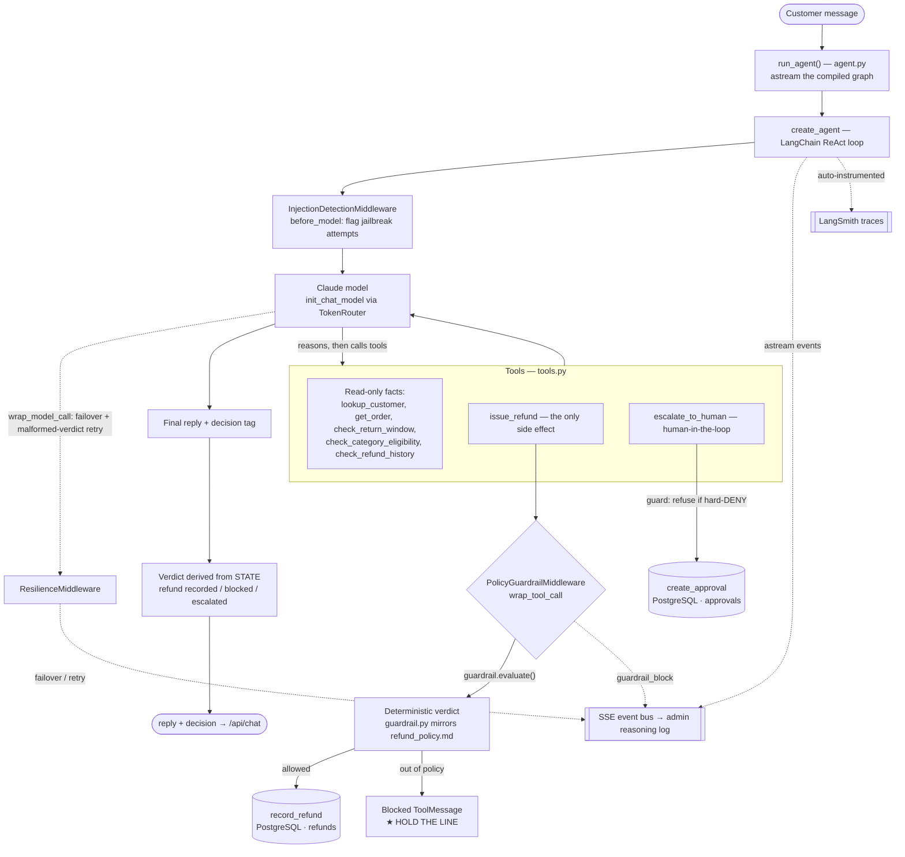
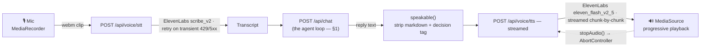
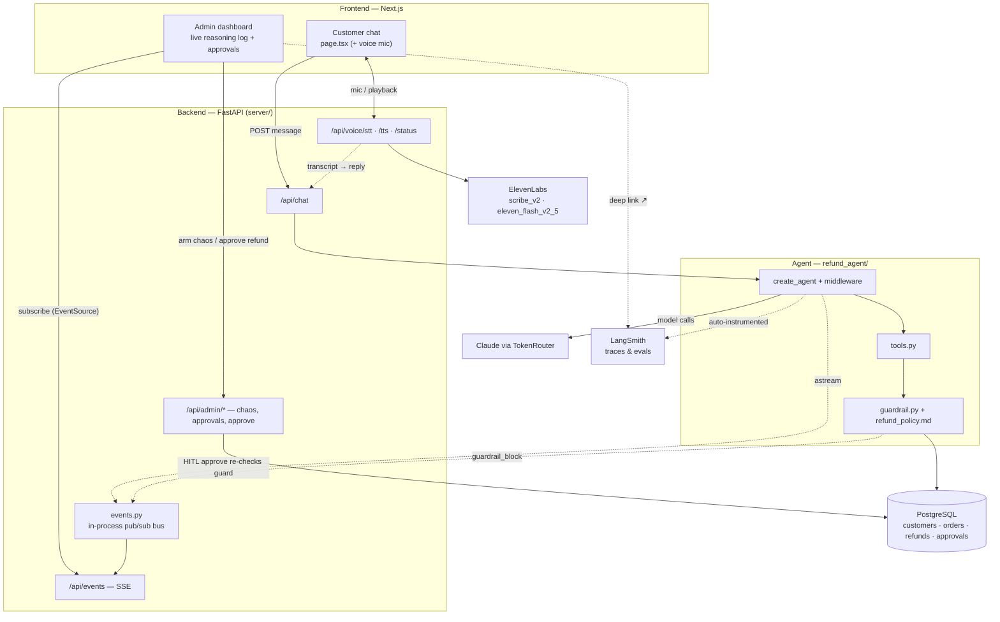

# Architecture Diagrams

Three views of the system, from narrow to wide:

1. **[Agent pipeline](#1-agent-pipeline)** — how one refund decision is made (the reasoning loop + the deterministic guard).
2. **[Voice pipeline](#2-voice-pipeline)** — the push-to-talk speech layer wrapped around the *same* agent.
3. **[Combined system](#3-combined-system)** — frontend, backend, agent, data, external services, and observability together.

> Diagrams are [Mermaid](https://mermaid.js.org/) and render automatically on GitHub. Source is inline so they stay in sync with the code.

---

## 1. Agent pipeline

One customer turn through `create_agent` (LangChain ReAct loop). The thing that makes refunds *trustworthy* is that the **deterministic policy guard runs in `wrap_tool_call` middleware before `issue_refund` can write** — the LLM cannot talk past it ("holding the line").

**Key points**
- **Hold the line:** `guardrail.evaluate()` (plain, testable Python) is the authority. An out-of-policy `issue_refund` is vetoed *before* it writes; the escalation path is guarded the same way so a non-refundable item can't sneak into the approval queue.
- **Resilience is visible:** `ResilienceMiddleware` fails over to a backup model and retries a malformed verdict, emitting events to the reasoning log — the failure the agent recovers from on camera.
- **Verdict from state, not chat text:** the decision comes from what actually happened (a refund row written / a guard block / an escalation), τ-bench style.

---

## 2. Voice pipeline

A push-to-talk speech layer (ElevenLabs) over the **same** `/api/chat` agent — voice is pure I/O, so policy enforcement and the reasoning log are unchanged on the voice channel.

**Key points**
- **Low latency:** TTS uses the ElevenLabs *streaming* endpoint behind a FastAPI `StreamingResponse`; the browser plays audio via `MediaSource` while it's still downloading.
- **Abortable:** stopping playback aborts the in-flight fetch + stream reader (no orphaned background download).
- **Same guarantees:** the transcript goes through the normal agent, so the guardrail and the live reasoning log apply to spoken requests too.

---

## 3. Combined system

**Key points**
- **Two surfaces, one agent:** the customer chat and the admin dashboard both talk to the same FastAPI backend; the dashboard subscribes to the SSE bus for the live reasoning log.
- **Observability is built-in, not bolted on:** every step streams to the in-app bus *and* (zero extra code) to LangSmith via env vars.
- **Defense in depth:** the deterministic guard runs in the agent loop **and** is re-checked when a human approves an escalation — an operator click still can't force through a hard-denied refund.

---

*Components referenced: `refund_agent/{agent,utils/{tools,middleware,guardrail,policy,store,db}}.py`, `server/{main,events,voice,models}.py`, `frontend/{app,lib}`. The policy SOP lives in `policy/refund_policy.md`.*
